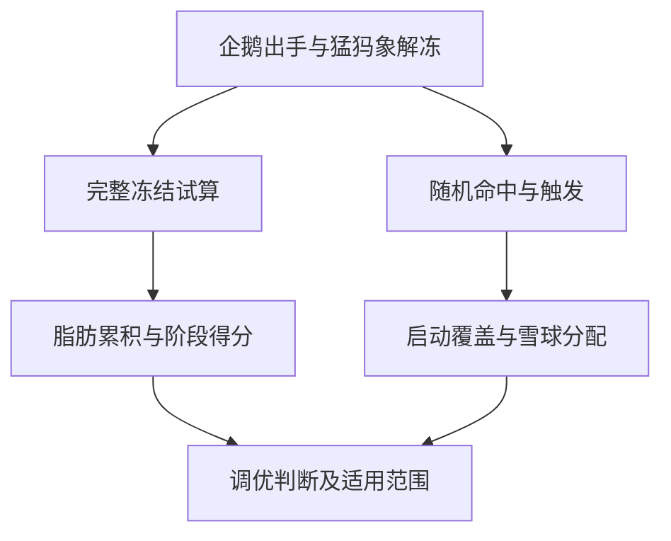

# 极地流｜游戏数值机制拆解与随机模拟

> **主稿** [极地流.docx](极地流.docx)
>
> 《猫神牧场》DLC《冻感极地》数值拆解，比较冻结循环的启动表现、得分增长与倍率调优。

## 项目概览

企鹅发射雪球触发冻结，猛犸象解冻后，企鹅可以再次出手。每触发一次冻结，该企鹅后续就多发一枚雪球。皮下脂肪又能永久提高基础分倍率，放大得分增长。

**确定性试算**在固定阵容和完整冻结的条件下比较四种倍率规则。**轮次级随机模拟**比较两种出手顺序下的冻结覆盖和雪球分配。机制推导和方案取舍见[极地流.docx](极地流.docx)。

## 快速阅读

| 阅读目标 | 入口 | 关注内容 |
| --- | --- | --- |
| 阅读主稿 | [极地流.docx](极地流.docx) | 冻结循环、成长阶与方案取舍 |
| 动手比较倍率规则 | [交互分析](配套材料/极地流-交互分析.html) | 改门槛与倍率、点选阶段、查看逐回合得分 |
| 核对模型和数值 | [数值模型工作簿](配套材料/极地流-数值模型.xlsx) | 逐回合公式、阶段阈值和随机实验数据 |
| 查看随机实验 | [蒙特卡洛模拟](配套材料/验证/极地流蒙特卡洛模拟.md) | 两种出手顺序的实验设定、统计结果和复算命令 |

## 机制与建模约定

| 项目 | 定义 |
| --- | --- |
| 阵容 | x 组，每组 1 只企鹅和 1 只猛犸象，共 2x 只动物 |
| 初始雪球 | 每只企鹅首次出手发射 5 枚 |
| 冻结与成长 | 第 2 次命中使目标冻结，完成冻结的企鹅从下次出手起永久多发 1 枚雪球 |
| 再次出手 | 回合首轮全体企鹅出手。猛犸象解冻后，刚被冻住的企鹅再次出手 |
| 循环上限 | 一回合最多有 x + 1 轮企鹅出手。得分试算按 x 轮解冻结算 |
| 皮下脂肪 | 试算中将每轮的全场冻结量除以 5 并向下取整，累计后按全场动物数平均分配 |
| 回合得分 | 无脂肪倍率的解冻得分乘以回合末的倍率 |
| 阶段判定 | 每阶段累计 10 个回合。无尽第 n 阶段阈值取 36,000 × n! |

得分试算从首回合起采用完整冻结。随机模拟每轮重置命中数，在发射者以外的动物中等概率选择目标。若一轮没有冻住任何企鹅，该回合的出手就此结束。

## 分析框架



### 长期成长

原版每累计 10 层脂肪便翻倍。策划改版的新增成本依次为 5、10、20、40 层，累计门槛为 5、15、35、75 层。两种备选方案分别每 5 层和每 10 层提高一次倍率，首次升至 2 倍，此后每档加 2。

5 组阵容在第 1 和第 2 回合末平均累积 3.5 层和 13 层脂肪，四种规则都在第 2 回合首次翻倍。到无尽第 11 阶段，策划改版、每 5 层方案和每 10 层方案分别达到阈值的 0.48、1.56 和 0.78 倍。每 5 层方案通过了这一阶段，至第 12 阶段首次未达标。原版在试算的前 30 阶段全部达标。

### 启动与波动

随机实验观察首轮全冻、整回合全体至少冻结一次、全轮满冻结。全轮满冻结要求达到 x + 1 轮且每轮都冻住全场。报告还比较雪球总量和个体占比。

以 5 组阵容为例，首回合只有 0.1% 的样本全轮满冻结。到第 3 回合，每轮随机与固定顺序分别达到 99.0% 和 98.3%。第 30 回合，两组当回合平均累计雪球都约为 10,600 枚，首轮最大单只雪球占比均值分别为 23.6% 和 86.2%。

## 实验与数据

确定性模型涵盖 2 至 15 组阵容、每组前 30 个无尽阶段。工作簿逐回合列出无倍率基础分、脂肪层数与倍率。网页沿用同一套口径，可追加自选规则。

随机实验覆盖 2 至 6 组阵容。每种阵容、每种顺序各运行 1,000 条轨迹，每条连续 30 回合，命中种子基数为 `20260828`。对照 CSV 有 300 行统计，固定顺序 CSV 保留其中固定组的 150 行。网页可更换样本量和命中种子重新运行。

## 文件组织

```text
极地流.docx                        主稿
README.md                          阅读指引
配套材料/
    极地流-交互分析.html            离线交互分析
    极地流-数值模型.xlsx            公式、得分与实验数据
    验证/
        极地流蒙特卡洛模拟.md       实验报告
        数据/
            极地流_出手顺序对照.csv
            极地流_固定顺序.csv
        脚本/
            阶段得分复算.py
            蒙特卡洛复算.py
    游戏截图/                      技能、天赋、脂肪词条与高分记录
```

## 代码与复现边界

| 脚本 | 职责 |
| --- | --- |
| [阶段得分复算.py](配套材料/验证/脚本/阶段得分复算.py) | 计算四种规则的阶段得分比、达标状态及首次未达标阶段 |
| [蒙特卡洛复算.py](配套材料/验证/脚本/蒙特卡洛复算.py) | 按阵容、轨迹数量与种子重新生成随机和固定顺序的统计结果 |

脚本使用 Python 3.10 或以上版本的标准库。在作品集根目录运行以下命令，复算结果会写入单独的 CSV。

```sh
python "配套材料/验证/脚本/阶段得分复算.py" --groups 5 --stages 15 --output "阶段得分试算.csv"
python "配套材料/验证/脚本/蒙特卡洛复算.py" --groups 5 --trials 1000 --seed 20260828 --output "出手顺序试算.csv"
```

蒙特卡洛脚本无参数运行时，会按默认设置刷新 `配套材料/验证/数据` 中的两份 CSV。

## 数值策划视角

1. **看首次翻倍的门槛和回合。** 一回合内可能跨过多个档位，改层数未必改变触发回合。
2. **看首次未达标阶段和上贡分差。** 策划改版与每 10 层方案在同一阶段首次未达标，离阈值的距离仍有差异。
3. **看雪球总数和个体分布。** 全队发射量接近时，雪球仍可能集中在少数企鹅身上。

## 适用范围

- 得分试算依赖完整冻结、固定阵容和脂肪平均分配，并按模型给定的顺序取整。它适合比较成长趋势与规则差异。
- 36,000 × n! 是本文采用的上贡阈值模型。首次未达标后的阶段得分是继续试算的结果。
- 随机实验记录冻结与雪球，不估计逐事件得分或通关概率。有限样本出现 100% 全轮满冻结时，只表示该批样本未观察到失败。
